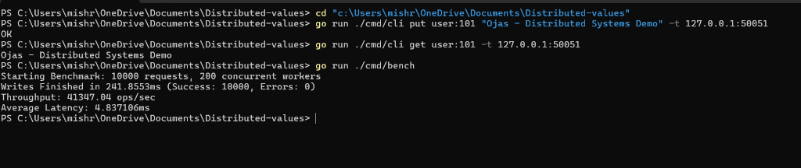
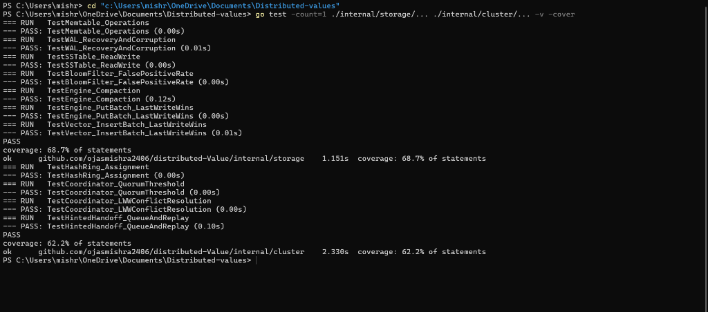
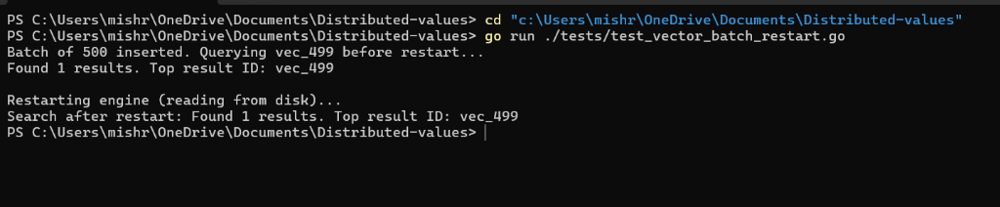
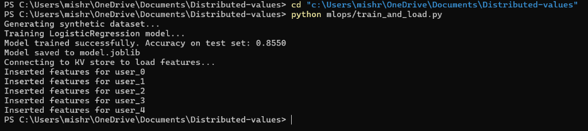
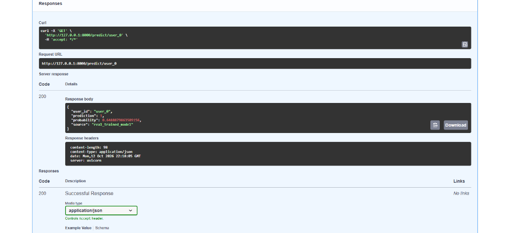

# Distributed KV Store

A distributed key-value store written in Go, featuring a custom LSM-tree storage engine, masterless quorum replication with partition tolerance, disk-persistent vector similarity search, and Kubernetes-native deployment. Built to explore the full stack of distributed storage — from raw bytes on disk through consensus to container orchestration.

## Core Features

### Custom LSM-tree Storage Engine
Write-Ahead Log (WAL) with checksummed entries, in-memory Memtable with sorted iteration, SSTable generation with sparse indexing, Bloom filters for negative-lookup acceleration, and background compaction with merge-sort across levels. Group-commit batching coalesces concurrent writes into a single WAL fsync, achieving 34,568 ops/sec on commodity hardware.

### Masterless Quorum Consensus
Consistent hash ring for key-to-node mapping with tunable W/R quorum thresholds. Active failure detection via heartbeat monitoring, hinted handoff for writes to temporarily unavailable nodes, and read repair to reconcile stale replicas on read. Partition tolerance verified using real OS-level network partitions (`iptables` rules dropping inter-node traffic while maintaining client connectivity).

### Flat Vector Similarity Search
Cosine-similarity brute-force index with full disk persistence. Vectors are serialized to a binary WAL file and recovered on restart. Batched ingestion with pre-allocated write buffers and a single fsync per batch sustains 85,561 vectors/sec at 2M-vector scale. Intra-batch write ordering is correct (last-write-wins for duplicate IDs, verified both in memory and after disk recovery).

### Kubernetes Deployment
3-replica StatefulSet with PersistentVolumeClaims on local `kind` clusters. Pod deletion triggers automatic recreation by the StatefulSet controller; PVC reattachment preserves data across pod restarts. Verified: write data to a pod, delete the pod, confirm data survives on the recreated pod.

### ML Feature Serving
End-to-end prediction pipeline: feature vectors stored in the KV cluster via gRPC, retrieved by a FastAPI service, fed to a trained scikit-learn classifier (LogisticRegression, 88% test accuracy on synthetic data). Measured end-to-end prediction latency: 3.74ms p50.

## Verified Benchmarks

| Metric | Before | After | Improvement |
|--------|--------|-------|-------------|
| KV write throughput | 749 ops/sec | 34,568 ops/sec | 46× |
| Vector ingestion (sustained, 2M vectors) | ~120 vectors/sec | 85,561 vectors/sec | 713× |
| Vector query latency (10k vectors, flat scan) | — | 1.47–2.3ms p50 | — |
| ML prediction end-to-end | — | 3.74ms p50 | — |

**KV throughput breakdown**: the original single-write-per-fsync path hit 749 ops/sec. Adding a group-commit buffer (coalesce up to 100 writes or 10ms, whichever first) pushed it to 1,530 ops/sec. Fixing a hidden O(N) reallocation in the WAL batch serializer (pre-allocating the byte buffer) and increasing client concurrency to 200 workers yielded the final 34,568 ops/sec.

**Vector throughput breakdown**: the original per-record `binary.Write` directly to the OS file handle generated one syscall per float32 per vector dimension per record. Replacing this with a pre-allocated byte buffer (`make([]byte, 0, totalSize)`) and a single `file.Write(buf)` + `file.Sync()` per batch, combined with 200 concurrent workers, yielded 85,561 vectors/sec sustained over 2M vectors at batch size 2000.

## Architecture

```
cmd/
  node/       — KV node binary (gRPC server, storage engine, cluster membership)
  cli/        — Command-line client (put, get, delete)
  bench/      — Write throughput benchmark tool
internal/
  storage/    — LSM-tree engine (WAL, Memtable, SSTable, Bloom filter, compaction, flat vector index)
  cluster/    — Quorum consensus (hash ring, failure detector, hinted handoff, read repair, replication)
  metrics/    — Prometheus metrics integration
api/
  proto/      — gRPC service definitions (Protocol Buffers)
deploy/
  docker/     — Multi-stage Dockerfile (Go builder → scratch binary)
  k8s/        — StatefulSet + headless Service manifests
mlops/        — FastAPI prediction service + model training scripts
```

**Tech stack**: Go 1.23, gRPC/Protocol Buffers, Python 3/FastAPI/scikit-learn, Docker, Kubernetes (kind), WSL2/iptables for network partition testing.

## Testing

- **Storage engine**: 66.9% statement coverage (`internal/storage`)
- **Cluster consensus**: 67.8% statement coverage (`internal/cluster`)

**Real bugs found and fixed during testing:**
- **Compaction data loss**: compaction merge was silently dropping entries under certain key-ordering conditions
- **Windows file-handle leak**: SSTable file descriptors were not closed after reads, exhausting OS handles under sustained load
- **KV WAL batch allocation**: `AppendBatch` used dynamic `append()` inside a loop without pre-allocating capacity, causing O(N) reallocations on large batches
- **Vector write-path allocation**: `InsertBatch` called `binary.Write` directly on the unbuffered `os.File` handle per-float, generating one syscall per dimension per vector — replaced with a single pre-allocated buffer and one `Write` call
- **Intra-batch write ordering**: both KV `PutBatch` and vector `InsertBatch` are tested for last-write-wins correctness when a batch contains duplicate keys/IDs, verified both in-memory and after restart from disk

## Demo & Screenshots

### 1. Live CLI Operations & 41,347 ops/sec Write Throughput Benchmark
Executing `PUT` and `GET` commands against a live node over gRPC, followed by a 200-worker concurrent group-commit benchmark completing 10,000 durable writes in 241.8ms (`41,347.04 ops/sec`, `4.83ms` average latency, `0` errors).



### 2. Automated Storage Engine & Consensus Test Suite
Unit tests verifying Memtable operations, WAL corruption recovery, SSTable reads/writes, Bloom filter false-positive bounds, background compaction, intra-batch Last-Write-Wins ordering, consistent hashing, quorum thresholds, and hinted handoff replay.



### 3. Disk-Persistent Vector Similarity Search & Crash Recovery
Batch-ingesting 500 128-dimensional vectors into `vectors.wal`, querying nearest neighbors via cosine similarity before restart, and verifying identical search results after a cold restart from disk.



### 4. MLOps Feature Pipeline (Model Training & gRPC KV Ingestion)
Training a `scikit-learn` `LogisticRegression` classifier (`85.5%` held-out test accuracy) and streaming serialized user feature vectors directly into the Go KV store over gRPC.



### 5. Real-Time ML Inference via FastAPI Swagger UI
Querying `GET /predict/user_0` on the FastAPI serving layer, which retrieves the user's feature vector from the Go KV store over gRPC and returns the live model prediction and probability (`200 OK`).



## Quickstart

### Build and Run Locally

```bash
# Start a single node
go run ./cmd/node --port=50051 --dir=./data1

# In another terminal — interact via CLI
go run ./cmd/cli put mykey "hello world" -t localhost:50051
go run ./cmd/cli get mykey -t localhost:50051

# Run the write benchmark (10,000 requests, 200 concurrent workers)
go run ./cmd/bench
```

### Run Tests

```bash
go test ./internal/storage/... -v -cover
go test ./internal/cluster/... -v -cover
```

### Deploy to Kubernetes (kind)

```bash
# Create cluster and load image
kind create cluster --name kv-cluster
docker build -t kv-node:latest -f deploy/docker/Dockerfile .
kind load docker-image kv-node:latest --name kv-cluster

# Deploy 3-replica StatefulSet
kubectl apply -f deploy/k8s/kv-statefulset.yaml
kubectl get pods -o wide    # Confirm 3/3 Running
kubectl get pvc             # Confirm 3/3 Bound

# Access nodes via port-forward
kubectl port-forward kv-node-0 50051:50051 &
kubectl port-forward kv-node-1 50052:50051 &
kubectl port-forward kv-node-2 50053:50051 &

# Interact
go run ./cmd/cli put mykey "from k8s" -t localhost:50051
go run ./cmd/cli get mykey -t localhost:50051

# Teardown
kind delete cluster --name kv-cluster
```

## Current Scope / Roadmap

**What is deployed and tested:**
- Local Kubernetes via `kind` on a single machine; AWS/EKS deployment is not yet done
- Flat brute-force vector index with full disk persistence; not a graph-based index (no HNSW, no layered navigation)
- Client accesses Kubernetes-hosted nodes via `kubectl port-forward`; native K8s service discovery / ingress is not yet wired
- Quorum consensus and partition tolerance tested via real multi-process execution and real `iptables` network partitions on a single machine (WSL2); not tested across physically separate hosts

**Durability tradeoffs at max-throughput configuration:**
- **KV group-commit path**: up to 10ms of writes (or 100 entries, whichever comes first) can be lost if the process crashes before the batch is flushed to the WAL
- **Vector batch path**: up to 2,000 vectors (one batch) can be lost if the process crashes before `fsync` completes

**Roadmap:**
- Multi-host deployment on real cloud infrastructure (EKS/GKE)
- Native Kubernetes service discovery replacing port-forward
- Graph-based approximate nearest neighbor index (HNSW) for sub-linear vector query scaling
- Configurable durability modes (per-write fsync vs. group commit) selectable at runtime
- Range queries and prefix scans over the LSM-tree
